# 🚀 CoursePilot

> **Transform YouTube courses and playlists into interactive, intelligent study workspaces.**  
> Powered by BGE-M3 Dense + Sparse Hybrid Search, Cross-Encoder Reranking, and Instructor-Grounded AI Synthesis.

[](https://course-pilot-eight.vercel.app)
[](https://fastapi.tiangolo.com/)
[](https://nextjs.org/)
[](https://github.com/FlagOpen/FlagEmbedding)
[](https://www.trychroma.com/)
[](https://clerk.com/)

---

## 💡 Why CoursePilot?

YouTube is home to the world's best educational content—from 10-hour engineering semester one-shots (AKTU, GATE) to UPSC marathons and full-stack bootcamps. However, **passively watching hours of video is one of the least effective ways to learn**:

- Students pause every 30 seconds to jot down incomplete notes.
- Finding the exact 2 minutes where a professor explained a tricky theorem requires scrubbing through hours of video.
- There are no structured quizzes or flashcards to test retention before exams.
- Generic AI chatbots hallucinate outside information rather than answering based on **what your teacher actually taught**.

**CoursePilot changes this.** Paste any YouTube video or playlist link, and CoursePilot synthesizes the entire course into a unified study hub: complete textbooks, exam notes, dynamic multi-set quizzes, spaced-repetition flashcards, and an AI teaching assistant with timestamp citations.

---

## 🌟 Key Features

### 1. 📖 Dual-Mode Study Notes
- **Zero-Omission Deep Notes:** Compiles the video lecture into a comprehensive textbook chapter. Captures every definition, mathematical formula, comparison table, ASCII architecture diagram, and instructor example without cutting corners.
- **Full-Coverage Quick Notes:** Crisp, bulleted revision summaries designed for rapid review right before entering the exam hall.
- **Export to PDF:** Download professionally styled study guides for offline reading and printing.

### 2. 🎯 Dynamic Multi-Set Testing (Quizzes & Flashcards)
- **4 Distinct Question Sets:** Rather than a static quiz, CoursePilot generates 4 balanced sets per lecture and playlist. Set 1 focuses on core concepts, Set 2 on mechanisms, Set 3 on deep architectural components, and Set 4 on tricky edge cases.
- **Seamless Loop-Around:** Once you master Set 1, unlock Set 2, Set 3, and Set 4 with zero delay.
- **Spaced Repetition Flashcards:** Active-recall cards with standard intervals (*Again, Hard, Good, Easy*) and mastery progress bars.

### 3. 🤖 Teacher-Grounded AI Teaching Assistant
- **Bilingual & Hinglish Native:** Understands lectures delivered in conversational Hindi/Hinglish (e.g., *"chaar main modules hote hain"*, *"ye past data ko yaad rakhta hai"*) and translates technical ideas into fluent, clean English explanations.
- **Exact Timestamp Citations:** Every answer cites `[Source 1]`, `[Source 2]` with clickable timestamps that jump directly to the exact second in the lecture.
- **Anti-Hallucination Pipeline:** If a concept was genuinely not covered in the course, the AI transparently informs the student rather than making up generic web answers.

### 4. 🌐 Zero-Cost Cloud Edge Tunnel & Auto-Sync
- Runs heavy neural embeddings (BGE-M3) locally on consumer GPUs (e.g. RTX 3050) while hosting the UI globally on Vercel.
- Uses Cloudflare Tunnels with an automated GitHub API coordinator: starting the local backend automatically connects remote devices (mobile / friends) to `https://course-pilot-eight.vercel.app` with zero configuration.

---

## 🏗️ Architecture & RAG Pipeline

```mermaid
flowchart TD
    subgraph Ingestion ["1. Course Ingestion Pipeline"]
        YT["YouTube Video / Playlist"] --> Trans["Transcript Extraction & Whisper Fallback"]
        Trans --> Chunker["Semantic Sliding Window Chunker (500 tokens, 100 overlap)"]
        Chunker --> BGE["BGE-M3 Neural Model (PyTorch GPU)"]
        BGE -->|Dense 1024-d Vectors| Chroma[("ChromaDB Vector Store")]
        BGE -->|Lexical Token Weights| SQLite[("SQLite BM25 Sparse Index")]
    end

    subgraph Query ["2. Production Hybrid Retrieval Pipeline"]
        UserQ["Student Question"] --> EncQ["BGE-M3 Query Encoding"]
        EncQ --> DenseSearch["Dense Vector Search (Top 40 Candidates)"]
        EncQ --> SparseSearch["Sparse Inverted Index Search (Top 40 Candidates)"]
        DenseSearch & SparseSearch --> RRF["Reciprocal Rank Fusion (RRF k=60)"]
        RRF --> TopRRF["Top 25 Merged Candidates"]
        TopRRF --> CrossEnc["BGE-Reranker-Large (Cross-Encoder)"]
        CrossEnc --> Threshold{"Relevance Gate (Score >= 0.025)"}
        Threshold -->|Pass| DepthMerge["Depth Span Merger (Chronological Context)"]
        Threshold -->|Fail| Fallback["Grounded Fallback Response"]
        DepthMerge --> Gemini["Google Gemini 2.5 Flash Synthesis"]
        Gemini --> FinalAns["Grounded Answer + Timestamp Citations"]
    end
```



---

## 🛠️ Tech Stack

| Layer | Technologies | Purpose |
| :--- | :--- | :--- |
| **Frontend** | **Next.js 16** (App Router), **React 19**, **TypeScript** | Responsive client workspace, streaming UI, optimistic state updates |
| **Styling** | **Tailwind CSS v4** | Clean, distraction-free modern study workspace with Dark/Light mode |
| **Authentication** | **Clerk** | Secure multi-user authentication and per-user course isolation |
| **API Server** | **FastAPI**, **Uvicorn** | High-performance asynchronous REST backend with rate limiting |
| **Neural Embeddings** | **BAAI/bge-m3** (PyTorch / CUDA) | 1024-d multilingual dense vectors + learned sparse lexical weights |
| **Cross-Encoder** | **BAAI/bge-reranker-large** | Deep relevance scoring between question and candidate transcript passages |
| **Vector Database** | **ChromaDB** | Local persistent cosine similarity search |
| **Sparse Database** | **SQLite (WAL mode)** | Custom inverted index storing token IDs, chunk IDs, and BM25 weights |
| **LLM Generation** | **Google Gemini 2.5 Flash** | Sub-second synthesis for notes, quizzes, and grounded Q&A |
| **PDF Engine** | **ReportLab** | Server-side compilation of styled markdown notes into printable PDFs |
| **Edge Routing** | **Cloudflare Tunnels (`cloudflared`)** | Zero-cost SSL reverse proxy bridging local GPU to Vercel |

---

## 📁 Repository Structure

```text
CoursePilot/
├── backend/
│   ├── main.py                          # FastAPI application & REST route definitions
│   ├── tunnel_runner.py                 # Cloudflare tunnel auto-sync coordinator
│   ├── reindex_all_courses_real_vectors.py # Vector validation & batch reindexing engine
│   ├── requirements.txt                 # Python dependencies
│   └── services/
│       ├── answer_service.py            # Teacher-grounded Q&A generation & Gemini cascading
│       ├── bge_m3_service.py            # BGE-M3 model lazy-loader & inference mutex
│       ├── bge_m3_indexing_service.py   # GPU batch forward pass & storage orchestration
│       ├── bge_m3_vector_store_service.py # ChromaDB dense vector store interface
│       ├── chunking_service.py          # Semantic sliding-window chunker with timestamp preservation
│       ├── course_db_service.py         # SQLite relational operations (courses, notes, quizzes, progress)
│       ├── hybrid_search_service.py     # Parallel dense + sparse search with RRF & reranker
│       ├── indexing_service.py          # YouTube ingestion & background worker
│       ├── reranker_service.py          # BGE cross-encoder reranking engine
│       ├── rrf_service.py               # Reciprocal Rank Fusion algorithm
│       ├── sparse_index_service.py      # SQLite inverted index for learned lexical weights
│       ├── study_tools_service.py       # Multi-set quiz (Sets 1-4) & flashcard generation
│       ├── transcript_service.py        # YouTube transcript extraction with Whisper fallback
│       └── youtube_service.py           # YouTube playlist & video metadata resolution
│
├── frontend/
│   ├── app/
│   │   ├── page.tsx                     # Main interactive study workspace
│   │   ├── admin/page.tsx               # Analytics, telemetry & user feedback portal
│   │   ├── layout.tsx                   # Root HTML shell & Clerk provider
│   │   └── sign-in/ & sign-up/          # Clerk authentication flows
│   ├── middleware.ts                    # Clerk authentication route guard
│   └── next.config.ts                   # Next.js build configuration
│
├── run_coursepilot.bat                  # 1-Click launcher: Backend + Frontend + Browser
├── start_backend.bat                    # 1-Click launcher: FastAPI API server (Port 8000)
├── start_frontend.bat                   # 1-Click launcher: Next.js dev server (Port 3000)
├── start_tunnel.bat                     # 1-Click launcher: Cloudflare Edge Tunnel with Auto-Sync
└── live_tunnel.txt                      # Live edge tunnel status file
```

---

## ⚡ Quickstart Guide

### Prerequisites
- **Python 3.10+** (NVIDIA CUDA recommended for fastest BGE-M3 inference)
- **Node.js 18+** & **npm**
- A free **Google Gemini API Key** ([Google AI Studio](https://aistudio.google.com/))
- A free **Clerk Account** ([Clerk.com](https://clerk.com/))

### 1. Clone the Repository
```bash
git clone https://github.com/krishnaventure664-alt/CoursePilot.git
cd CoursePilot
```

### 2. Configure Environment Variables

**Backend (`backend/.env`):**
```env
GEMINI_API_KEY=your_gemini_api_key_here
CHROMA_DIR=chroma_db
SQLITE_DB_PATH=sparse_index.db
CORS_ORIGINS=http://localhost:3000,https://course-pilot-eight.vercel.app
```

**Frontend (`frontend/.env.local`):**
```env
NEXT_PUBLIC_CLERK_PUBLISHABLE_KEY=your_clerk_publishable_key
CLERK_SECRET_KEY=your_clerk_secret_key
NEXT_PUBLIC_CLERK_SIGN_IN_URL=/sign-in
NEXT_PUBLIC_CLERK_SIGN_UP_URL=/sign-up
NEXT_PUBLIC_CLERK_AFTER_SIGN_IN_URL=/
NEXT_PUBLIC_CLERK_AFTER_SIGN_UP_URL=/
NEXT_PUBLIC_API_URL=http://127.0.0.1:8000
```

### 3. Launch with 1-Click (Windows)
Simply double-click:
```text
run_coursepilot.bat
```
This automatically boots up the FastAPI backend on port 8000, starts the Next.js dev server on port 3000, and opens [http://localhost:3000](http://localhost:3000) in your default browser.

### 4. Manual Launch (Linux / macOS / PowerShell)

**Backend:**
```bash
cd backend
python -m venv venv
# Windows: venv\Scripts\activate | Unix: source venv/bin/activate
pip install -r requirements.txt
uvicorn main:app --host 127.0.0.1 --port 8000 --reload
```

**Frontend:**
```bash
cd frontend
npm install
npm run dev
```

---

## 📡 Remote / Mobile Access (Cloudflare Tunnel)

To access your GPU-powered backend from your mobile phone or share the app with friends:

1. Double-click `start_backend.bat`
2. Double-click `start_tunnel.bat`

The tunnel runner automatically connects to Cloudflare's edge network, records the live tunnel address, and syncs it. Friends can simply navigate to:

> 🔗 **https://course-pilot-eight.vercel.app**

The web app auto-connects to your laptop's backend in under a second with **zero manual configuration required**.

---

## 📊 Key Engineering Optimizations

- **GPU Inference Mutex:** A thread-safe mutex prevents concurrent PyTorch CUDA forward passes from exceeding VRAM capacity on 4GB / 6GB laptop GPUs.
- **SQLite WAL & Busy Timeouts:** Configured with `PRAGMA busy_timeout = 60000;` and Write-Ahead Logging (`WAL`) to eliminate `database is locked` exceptions during high-frequency concurrent chunk insertions.
- **Zero-F5 Background Ingestion:** Frontend uses real-time progress polling with optimistic UI updates, allowing users to browse existing notes while new lectures index in the background.
- **Instant Client Caching:** In-memory client maps provide instant 0ms tab switching between Quick Notes, Deep Notes, Quizzes, and Flashcards without re-fetching from the network.

---

## 📜 License

Distributed under the **MIT License**. See `LICENSE` for more information.

---

<p align="center">
  <b>Built with ❤️ for curious minds and ambitious students.</b><br/>
  <i>Turn any video into your personal university lecture hall.</i>
</p>
